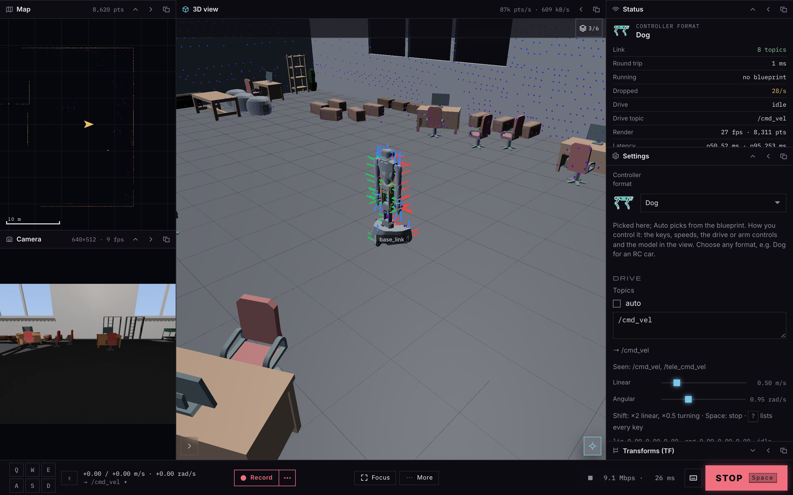

# dim-r1-sim

A simulated Galaxea R1 Pro for [dimOS](https://github.com/dimensionalOS/dimos), as one module:
`cmd_vel` in; the chassis Livox Mid-360, the head's two colour cameras, odometry and tf out. It
stands in office_555, the default room of dimOS's MuJoCo sim, and is the R1 counterpart of
[dim-go2-sim](https://github.com/jeff-hykin/dim-go2-sim).



## Quick start

```bash
uv venv --python 3.12 && uv pip install -e .
.venv/bin/python examples/drive.py
```

[`examples/drive.py`](examples/drive.py):

```python
import sys

from dimos.core.coordination.blueprint_config.parser import BlueprintConfigParser
from dimos.core.coordination.module_coordinator import ModuleCoordinator

from dim_r1_sim import R1Sim

drive = R1Sim.blueprint().global_config(transport="zenoh")

if __name__ == "__main__":
    ModuleCoordinator.build(drive, BlueprintConfigParser(drive).parse(sys.argv[1:])).loop()
```

The first run downloads the office (1.2 MB, dimOS's LFS archive of it, checked by its sha256) and
clones Galaxea's URDF repo into dimOS's robot asset cache, as dimOS does for the real robot. Then it
publishes lidar at 10 Hz, both eyes at 10 fps, odom and tf at 50 Hz over zenoh, so dimOS
Desktop's Controller app shows it standing in the office and drives it with W/A/S/D.

## Streams

| stream | type | |
|---|---|---|
| `cmd_vel` (in) | `Twist` | base_link's vx, vy, wz, held for `physics.command_timeout`, then the base stops |
| `lidar` | `PointCloud2` | one 0.1 s scan, in `lidar_chassis_left_link` where each ray fired, with per-point `offset_times` and `lines` |
| `color_image`, `camera_info` | `Image`, `CameraInfo` | the left head camera, RGB, in `camera_head_left_link` (an optical frame) |
| `right_color_image`, `right_camera_info` | `Image`, `CameraInfo` | the right one |
| `odom` | `PoseStamped` | the true base pose in `world` |
| `tf` | `TFMessage` | `world` → `base_link`, then every URDF joint: the upper body at its pose, the swerve wheels steered and rolled to the base's velocity |
| `robot_description` | `std_msgs.String` | the robot and the office as one URDF, every 5 s, for [dim-controller](https://github.com/jeff-hykin/dim-controller) |
| `file_request` (in), `file_info` | `std_msgs.String`, `files.MeshFile` | a file the URDF names, asked for and sent; an empty request gets `robot_description` right away |

The URDF is shared as dim-go2-sim's is (dimOS's `UrdfManager` scheme): meshes named
`package://dim_r1_sim/<path>?hash=<sha256>`, the root `world`, `base_link` on a floating joint and
every other link on its URDF joint, each posed by tf. The robot's meshes are Galaxea's STL files as
they are (48 MB). The office is `scene_mesh` (`<group>scene</group>`): every geom the camera
draws, both storeys, one visual per colour. The controller has no skybox: the sky is only in the
head cameras' images.

## Config

`R1SimConfig` has a section per part, each overridable from a blueprint or the dimOS CLI:

- `scene`: `office_dir` (e.g. a dimos checkout's `data/mujoco_office_555`), `start` (x, y, yaw)
- `robot`: `urdf`, `joint_positions` (what it stands at; 0 is upright, arms down)
- `physics`: `timestep`, `control_dt`, `max_velocity`, `max_acceleration`, `command_timeout`,
  `realtime`, `cache_dir`
- `lidar`: `enabled`, `frame`, `rate_hz`, `point_rate_hz`, `downsample`, `min_range`, `max_range`,
  `noise`, `dropout`, `self_occlusion`, `motion_bins_hz`, `seed`
- `camera`: `enabled`, `rate_hz`, `left_frame`, `right_frame`, `right`, `width`, `height`, `fovy_deg`
- `urdf`: `enabled`, `period_s`, `tile_faces`
- `office` (False: bare ground), `odom_hz`, `frame_prefix`

## How it works

- **Robot.** Galaxea's R1 Pro URDF (`r1pro_2026`, pinned by `dimos.robot.galaxea.r1pro.config`),
  so every frame is named as on the real robot. The links are posed once at the configured joint
  angles and welded to the base.
- **Base.** MuJoCo slides the base on planar joints (x, y, yaw), each with a velocity actuator
  whose force is capped at dimOS's R1 acceleration limits (`R1PRO_PLANAR_BASE`): it can't tip, and
  stops at what it runs into. Two boxes around the chassis and the upper body collide with the
  office's collision hulls. The swerve wheels are kinematic: tf steers and rolls them.
- **Lidar.** dim-go2-sim's Mid-360: the four-channel Fourier firing pattern, 200k points a second,
  cast in 5 ms slices from wherever the sensor is then, with range noise and grazing-angle
  dropout. The office's drawn surfaces and the R1's own meshes (its torso and arms beside the
  chassis lidar) both go through Embree.
- **Cameras.** MuJoCo draws each eye from the office's own materials and lights, the robot
  included, at the ISX031's aspect (640x512) and a fovy from its factory focal length. Headless
  Linux needs `MUJOCO_GL=egl`.

## Development

```bash
uv venv --python 3.12 && uv pip install -e . pytest
pytest
```

## Licenses

Apache-2.0. Neither the office nor the robot is bundled: office_555 is downloaded from dimOS's
LFS store, and Galaxea's URDF and meshes (their package says BSD) are cloned from
[userguide-galaxea/URDF](https://github.com/userguide-galaxea/URDF) by dimOS's asset cache.
